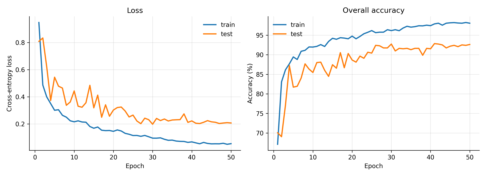
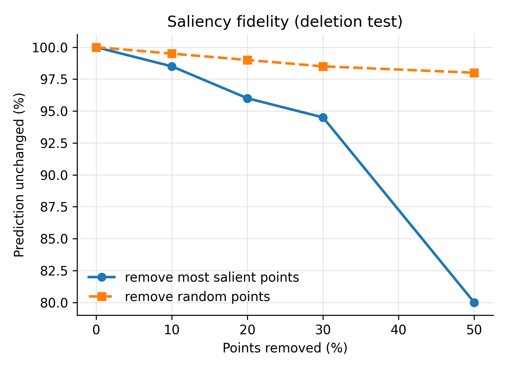
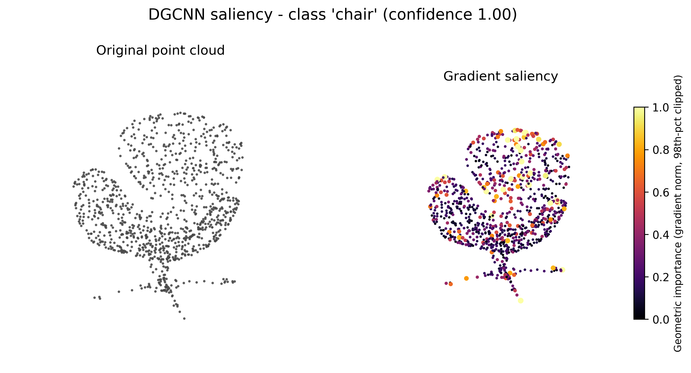
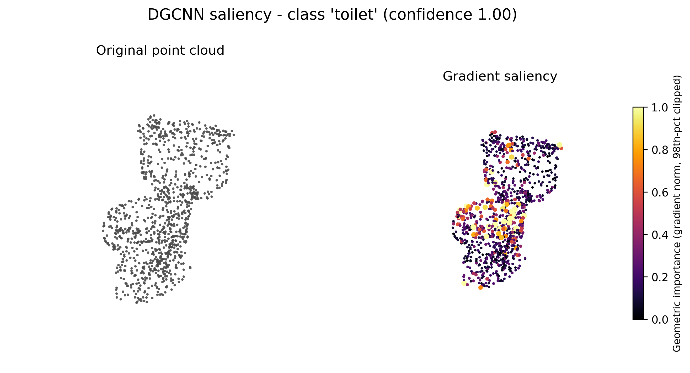

# Geometric Deep Learning on 3D Point Clouds: DGCNN Classification and Gradient-Saliency Explainability

This project connects **geometric deep learning on point clouds** with **interpretability of 3D spatial features**.
A Dynamic Graph CNN (DGCNN) built with PyTorch Geometric classifies ModelNet10 objects (1024 points each), and a
gradient-based saliency method shows which points drive each prediction. A deletion test quantitatively checks that the
saliency scores are meaningful. A PointNet++ model is included as a baseline implementation.

> **Scope note.** All experiments use ModelNet10 (household objects), not clinical or dental data. The goal is a
> reproducible pipeline for point-cloud classification and explainability that can be transferred to other 3D surface data.

## Architecture and Method

**DGCNN.** Each object is a point cloud treated as a graph. Four `DynamicEdgeConv`-style blocks (64, 64, 128, 256 channels,
BatchNorm + LeakyReLU) process it. In every block the k-nearest-neighbour graph (k = 20) is **rebuilt in the current feature
space**, not in 3D space, so a point can be linked to semantically similar points far away on the shape. For each edge the
block computes `h([x_i, x_j - x_i])` (local geometry plus context) and aggregates neighbours with max. The four block outputs
are concatenated, projected to 1024 channels and summarised by **global max + mean pooling**. A three-layer MLP with
**Dropout 0.5** produces class scores (softmax gives probabilities).
The block is implemented as a dynamic k-NN graph (plain PyTorch) followed by PyG's `EdgeConv`, which is the definition of
`DynamicEdgeConv` and avoids the optional `torch-cluster` / `pyg-lib` dependencies that recent PyG versions require.

**Preprocessing.** `SamplePoints(1024)` samples the mesh surface uniformly; each cloud is centred at the origin and scaled into
the unit sphere. Training augmentation: random rotation around the vertical axis and Gaussian noise (sigma = 0.01).

**Training.** AdamW (lr 1e-3, weight decay 1e-4), cosine learning-rate schedule, batch size 32, 50 epochs, seed 42.
The reported weights are those of epoch 41 (highest test accuracy). *No separate validation set was used, so the test set
also selected the checkpoint and the reported accuracy is slightly optimistic; accuracy over the last 10 epochs stays
between 91.7% and 92.8% (epochs 41-50).*

**Gradient saliency.** Input coordinates get `requires_grad`; for the predicted class `c` we compute
`d score_c / d(x, y, z)` for every point and take the Euclidean norm. Scores are min-max normalised to [0, 1] per object.
Renders clip the colour scale at the 98th percentile for readability.

**Deletion test (fidelity check).** On 200 correctly classified test objects, we remove the most salient points, or the same
number of random points, and measure how often the original prediction is unchanged.

## Quantitative Results

<!-- RESULTS_START -->
| Model | Overall accuracy | Mean per-class accuracy | Inference time / object |
|---|---|---|---|
| DGCNN | 92.84% | 92.68% | 6.19 ms (CUDA, Colab GPU, batch size 1) |
<!-- RESULTS_END -->

Per-class accuracy (908 test objects):

| Class | Acc. | Class | Acc. |
|---|---|---|---|
| bathtub | 98.0% | night_stand | 75.6% |
| bed | 99.0% | sofa | 98.0% |
| chair | 99.0% | table | 86.0% |
| desk | 87.2% | toilet | 99.0% |
| dresser | 86.0% | monitor | 99.0% |

The weakest classes (night_stand, table, dresser, desk) are geometrically similar to each other.

Saliency deletion test (share of predictions left unchanged):

| Points removed | Most salient first | Random |
|---|---|---|
| 10% | 98.5% | 99.5% |
| 20% | 96.0% | 99.0% |
| 30% | 94.5% | 98.5% |
| 50% | 80.0% | 98.0% |

Removing salient points disrupts predictions far more than removing random points, which supports the saliency scores as a
faithful indicator of the points the model relies on.




## Visual Analysis

Left: raw point cloud. Right: the same object coloured by geometric importance (gradient norm, clipped at the 98th percentile
for display).




Importance is concentrated on a minority of points. For the chair, the highest scores appear on the top edge of the backrest,
the tip of the armrest and the ends of the legs, while most of the seat surface receives low scores. For the toilet, the
bowl-tank junction is the most influential region. The maps are point-wise and therefore noisy; they should be read as
tendencies, not as precise segmentations.

## Installation and Execution

```bash
python -m venv venv && source venv/bin/activate        # Windows: venv\Scripts\activate
pip install torch                                       # see pytorch.org for your CUDA version
pip install -r requirements.txt

python data/download_and_preprocess.py --root data/ModelNet10   # automatic download (~450 MB)
python train.py --model dgcnn --epochs 50 --batch_size 32       # weights -> results/dgcnn_best.pt
python evaluate.py --model dgcnn                                # metrics, saliency renders, deletion test

# optional baseline
python train.py --model pointnet2 --epochs 50 && python evaluate.py --model pointnet2
```

A GPU is strongly recommended (about 70 s per epoch on a Colab GPU; CPU training is impractically slow).

## Project Structure

```
data/download_and_preprocess.py   dataset download, sampling, normalisation, augmentation
models/dgcnn.py, pointnet2.py     DGCNN (dynamic k-NN + EdgeConv, k=20) and PointNet++ baseline
utils/explainability.py           gradient saliency + deletion test
utils/visualization.py            300 DPI Matplotlib figures
train.py / evaluate.py            training loop and evaluation / explainability pipeline
```

## Limitations and Future Work

- Evaluated on ModelNet10 only; no clinical or dental data.
- PointNet++ is implemented but was not trained for the reported results.
- Gradient saliency is noisy at point level; smoothing (`--smooth k`) or integrated gradients could be compared.
- Natural next step: graph neural networks operating directly on mesh structure, and transfer to surface scans.
